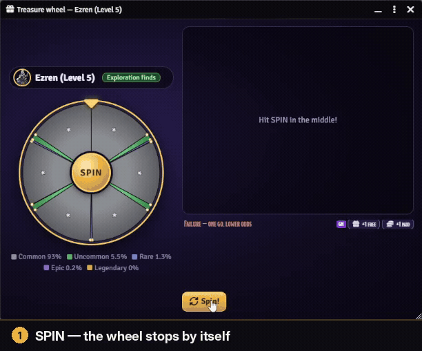
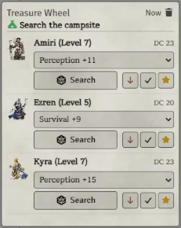
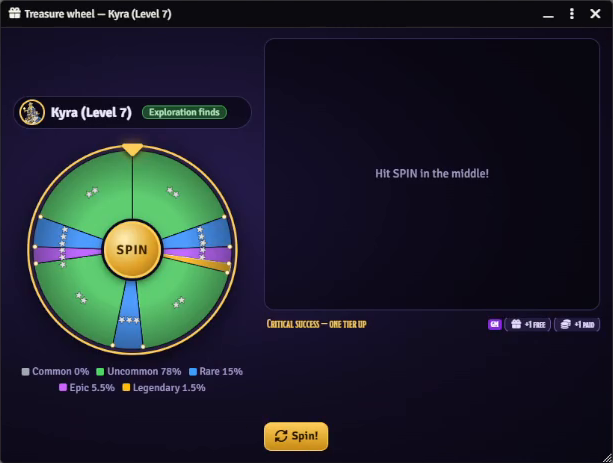

# Rutz's Gacha & Loot

[디스코드](https://discord.gg/bB7Ca666Bv) · [위키](https://github.com/Rutz179/rutz-pf2e-gacha/wiki/한국어-안내) · [English](README.md)

Foundry VTT용 **패스파인더 2판** 보상 기계입니다. 밤 휴식(Rest for the Night) 뒤 캐릭터마다 판정을 굴리고, 성공하면 야영지에서 찾은 물건을 뽑는 보물 룰렛이 열립니다. 대부분 음식·장비·물약이고, 가끔 특별한 것이 나옵니다. 돈을 내고 다시 돌린 뒤 나온 것이나 그 값어치의 현금을 받습니다. 모두 동시에 하거나, 한 명씩 하며 테이블이 함께 봅니다.



## 할 수 있는 것
- **휴식 뒤 기회** — PF2e의 밤 휴식이 끝나면 쉰 캐릭터 모두를 위한 카드가 채팅에 하나 올라옵니다. 플레이어가 게임의 판정 기술 중 하나를 골라 레벨 기준 DC로 굴립니다. 대성공은 한 등급 위, 실패도 낮은 확률로 한 번.
- **보물 룰렛** — 일반부터 전설까지 5등급. 다시 돌리기는 돈이 들고(레벨에 맞춰, 최대 3번), 마지막에 나온 것을 받거나 그 값어치를 현금으로 받습니다.
- **동시에, 또는 한 명씩** — 기본은 각자 자기 기회를 동시에 합니다. 한 명씩으로 하면 돌리는 모습이 누구 차례인지와 함께 모두의 화면에 나옵니다.
- **GM** — 러츠 툴킷(🎁)에서 언제든 기회를 주거나 카드에서 굴림 없이 주고, 모든 설정은 **가챠 관리** 창 하나에서. 보상 목록에서 특정 보상을 막거나 개수를 정합니다.
- **전리품 나누기** — 전투 뒤 GM이 한 창에서 물건과 현금을 나눠 줍니다. 레벨별 현금 상한이 있습니다.
- **가챠 기록** — 누가 언제 무엇을 뽑았는지.

 

## 설치
Foundry → *Add-on Modules* → *Install Module* → Manifest URL:
```
https://github.com/Rutz179/rutz-pf2e-gacha/releases/latest/download/module.json
```
Foundry VTT v13–v14 · 패스파인더 2판 시스템 · 한국어 / English (Foundry 언어 설정을 따름)

## 빠른 시작
1. PF2e 월드에서 모듈을 켭니다.
2. 밤 휴식을 하면 채팅에 **주변을 뒤져 보기** 카드가 올라옵니다. 플레이어마다 **뒤져 보기**를 누릅니다.
3. 성공하면 룰렛이 열립니다: **SPIN**, 원하면 다시 돌리고, **받기**.
4. GM: 러츠 툴킷 그룹의 🎁 버튼으로 언제든 기회를 줍니다.

전체 안내: **[위키](https://github.com/Rutz179/rutz-pf2e-gacha/wiki/한국어-안내)** · 매크로: `game.rutzGacha.offer(actors)`

질문·버그 제보: [Issues](https://github.com/Rutz179/rutz-pf2e-gacha/issues) 또는 [디스코드](https://discord.gg/bB7Ca666Bv).
