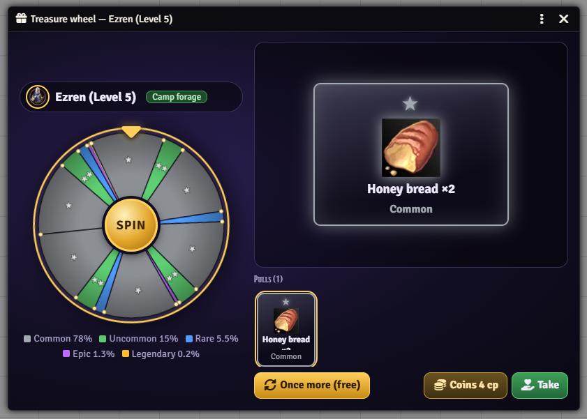
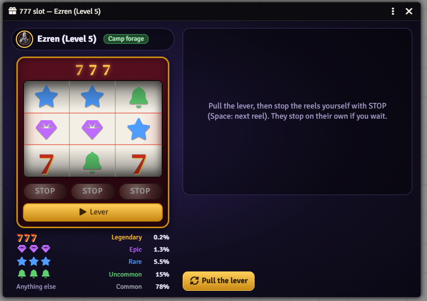
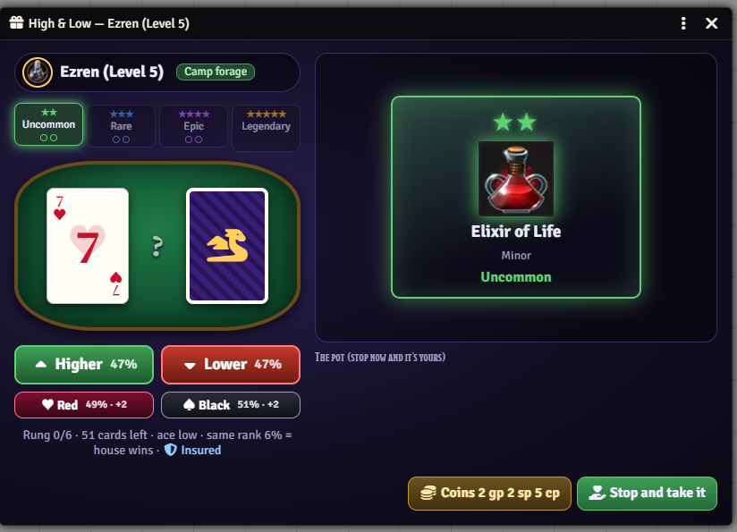

# Rutz's PF2e Gacha

Free Lite edition · [Plus on Patreon](https://www.patreon.com/Rutz179) · [Discord](https://discord.gg/pnVW5QmXKx) · [Wiki](https://github.com/Rutz179/rutz-pf2e-gacha/wiki) · [한국어](README.ko.md)

A reward machine for **Pathfinder 2e** in Foundry VTT. After Rest for the Night each character can try a check — success opens a treasure wheel of camp finds: mostly food, gear and potions, rarely something special. Pay to spin again, keep the pull you like, and the whole table watches.



## Features
- **Chance after rest** — PF2e's Rest for the Night posts one card for everyone who rested: a Survival check each against a level-based DC. A critical success gives a free extra spin.
- **Treasure wheel** — five tiers from common to legendary; re-spins cost coins (scaled to level, up to 3); take any pull, or its value in coins instead.
- **Everyone watches** — each spin plays on every screen, one at a time, with whose turn it is. Players queue up when several have a chance.
- **For GMs** — give a chance any time from the token controls, and set the check skill and DC.
- **Plus** — the **777 slot** (stop the reels yourself), **High & Low** (double up on a real deck of cards), **battle loot** after combat, an **item table editor** for every tier, and re-spin cost and keep rules.

 

## Lite & Plus
This is the free edition. The **Plus** features above come with the Plus tier on [Patreon](https://www.patreon.com/Rutz179): join for a month, install from the [Rutz Module Hub](https://rutz-hub.rutz179.workers.dev), and keep it — it keeps working after you cancel. Rejoin any time for newer versions. Same module, so worlds keep their data. During the open beta every feature is free.

## Install
Foundry → *Add-on Modules* → *Install Module* → Manifest URL:
```
https://github.com/Rutz179/rutz-pf2e-gacha/releases/latest/download/module.json
```
Foundry VTT v13–v14 · Pathfinder 2e system · English / 한국어 (follows Foundry's language)

## Quick start
1. Enable the module in a PF2e world.
2. Rest for the Night — a **Search the campsite** card appears in chat. Each player presses **Search**.
3. On a success the wheel opens: **SPIN**, spin again if you like, then **Take**.
4. GM: the 🎁 button in the token controls gives a chance any time.

Full guide: **[Wiki](https://github.com/Rutz179/rutz-pf2e-gacha/wiki)** · Macro: `game.rutzGacha.offer(actors)`

Questions and bug reports: [Issues](https://github.com/Rutz179/rutz-pf2e-gacha/issues) or [Discord](https://discord.gg/pnVW5QmXKx).
